# Tutorial: cómo crear el front-end Android de Guali

**Proyecto Guali — Fase 3 · Programación 2 · UMG**

Este tutorial explica, paso a paso y en orden, cómo construir el **front-end de una
aplicación móvil Android** con los elementos de la sección *Interfaz Principal* del
enunciado del proyecto: barra de menú, título de la lección activa, panel de la lección,
editor de código, panel de consola y botones **Compilar** y **Ejecutar**.

Al finalizar tendrás una aplicación funcional que:

- lee lecciones desde la carpeta `assets` del proyecto,
- permite escribir código Java a mano en un editor,
- compila y ejecuta el código con un motor local determinista,
- evalúa el objetivo de cada lección,
- guarda el historial de intentos en una base de datos SQLite,
- permite configurar la ruta del JDK y muestra ayuda al usuario.

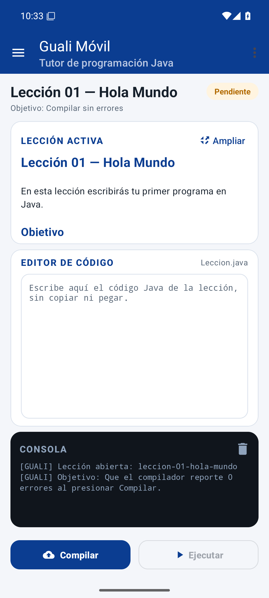

---

## Índice

1. [Prerrequisitos](#1-prerrequisitos)
2. [Instalación del software](#2-instalación-del-software)
3. [Crear el proyecto en Android Studio](#3-crear-el-proyecto-en-android-studio)
4. [Configurar Gradle y las dependencias](#4-configurar-gradle-y-las-dependencias)
5. [Recursos visuales: colores, temas, textos y menú](#5-recursos-visuales-colores-temas-textos-y-menú)
6. [Construir la interfaz principal](#6-construir-la-interfaz-principal)
7. [Modelo de datos y persistencia](#7-modelo-de-datos-y-persistencia)
8. [Cargar las lecciones desde assets](#8-cargar-las-lecciones-desde-assets)
9. [Motor de compilación y ejecución](#9-motor-de-compilación-y-ejecución)
10. [Utilidades: Markdown y consola](#10-utilidades-markdown-y-consola)
11. [Programar MainActivity](#11-programar-mainactivity)
12. [Panel de historial](#12-panel-de-historial)
13. [Manifest e icono de la aplicación](#13-manifest-e-icono-de-la-aplicación)
14. [Compilar, instalar y ejecutar](#14-compilar-instalar-y-ejecutar)
15. [Recorrido de la aplicación](#15-recorrido-de-la-aplicación)
16. [Pruebas sugeridas](#16-pruebas-sugeridas)
17. [Solución de problemas](#17-solución-de-problemas)
18. [Autor](#18-autor)

---

## 1. Prerrequisitos

### 1.1 Conocimientos

- Programación orientada a objetos y sintaxis básica de **Kotlin**.
- Nociones de **XML** para layouts de Android.
- Uso básico de la terminal (PowerShell en Windows, bash en macOS/Linux).

### 1.2 Hardware

| Recurso | Mínimo | Recomendado |
|---|---|---|
| Memoria RAM | 8 GB | 16 GB |
| Espacio libre en disco | 12 GB | 20 GB |
| Procesador | 64 bits con virtualización | 4 núcleos o más |
| Pantalla | 1280 × 800 | 1920 × 1080 |

> El emulador necesita **virtualización por hardware** (VT-x/AMD-V). Si el equipo usa
> Hyper-V o WSL2, el emulador funciona con el acelerador WHPX.

### 1.3 Software

| Software | Versión | Para qué se usa |
|---|---|---|
| Android Studio | Ladybug 2024.2.1 o superior | IDE, SDK Manager y emulador |
| JDK | 17 (el que incluye Android Studio) | Compilar con Gradle |
| Android SDK Platform | 35 (Android 15) | Compilar la aplicación |
| Android SDK Build-Tools | 35.0.0 | Empaquetar el APK |
| Android Emulator | API 35, imagen `google_apis/x86_64` | Ejecutar y probar la app |
| Gradle | 8.9 (wrapper incluido) | Construir el proyecto |
| Git (opcional) | 2.40 o superior | Clonar el repositorio |

---

## 2. Instalación del software

### 2.1 Instalar Android Studio

1. Descarga Android Studio desde
   <https://developer.android.com/studio>.
2. Ejecuta el instalador y deja las opciones por defecto:
   - **Android Studio**
   - **Android Virtual Device**
3. Al abrir Android Studio por primera vez, elige **Standard** en el asistente
   *Welcome to Android Studio*. El asistente descarga el SDK, las Build-Tools y el
   emulador.
4. Espera a que termine la descarga y presiona **Finish**.

### 2.2 Verificar el JDK

Android Studio incluye un JDK (JetBrains Runtime). Para comprobar que Gradle lo usa:

1. Abre **File > Settings** (Windows/Linux) o **Android Studio > Settings** (macOS).
2. Ve a **Build, Execution, Deployment > Build Tools > Gradle**.
3. En **Gradle JDK** selecciona **jbr-17** o **17**.

Si prefieres instalar un JDK aparte, descarga **Eclipse Temurin 17** desde
<https://adoptium.net/> y selecciónalo en esa misma pantalla.

Para verificar desde la terminal:

```bat
java -version
```

Debe responder con una versión 17 o superior.

### 2.3 Instalar el SDK de Android 35

1. En Android Studio abre **Tools > SDK Manager**.
2. En la pestaña **SDK Platforms** marca **Android 15.0 (API 35)**.
3. En la pestaña **SDK Tools** marca:
   - **Android SDK Build-Tools 35**
   - **Android Emulator**
   - **Android SDK Platform-Tools**
4. Presiona **Apply** y acepta las licencias.

### 2.4 Crear un emulador

1. Abre **Tools > Device Manager** y presiona **Create Virtual Device**.
2. Selecciona **Pixel 6** y presiona **Next**.
3. Elige la imagen **VanillaIceCream / API 35** (descárgala si aparece con una flecha).
4. Presiona **Next**, revisa el nombre y presiona **Finish**.
5. Inicia el emulador con el botón **Play**.

> Si el emulador no arranca, revisa que la virtualización esté habilitada en la BIOS y
> en **Administrador de Hyper-V** de Windows.

---

## 3. Crear el proyecto en Android Studio

1. Abre Android Studio y elige **New Project**.
2. Selecciona la plantilla **Empty Views Activity** y presiona **Next**.
3. Completa el formulario:

   | Campo | Valor |
   |---|---|
   | Name | `GualiMovil` |
   | Package name | `com.guali.movil` |
   | Save location | La carpeta donde trabajarás |
   | Language | **Kotlin** |
   | Minimum SDK | **API 24: Android 7.0 (Nougat)** |
   | Build configuration language | **Kotlin DSL** |

4. Presiona **Finish** y espera a que Gradle sincronice.
5. Presiona **Run** para comprobar que la plantilla arranca en el emulador.

La estructura inicial es:

```
GualiMovil/
├── app/
│   ├── build.gradle.kts
│   └── src/main/
│       ├── AndroidManifest.xml
│       ├── java/com/guali/movil/MainActivity.kt
│       └── res/
├── build.gradle.kts
├── settings.gradle.kts
└── gradle/
```

---

## 4. Configurar Gradle y las dependencias

### 4.1 `build.gradle.kts` de la raíz

Declara los plugins de Android y Kotlin:

```kotlin
plugins {
    id("com.android.application") version "8.7.3" apply false
    id("org.jetbrains.kotlin.android") version "2.0.21" apply false
}
```

### 4.2 `settings.gradle.kts`

Los repositorios de Google y Maven Central, y el módulo `:app`:

```kotlin
pluginManagement {
    repositories {
        google()
        mavenCentral()
        gradlePluginPortal()
    }
}

dependencyResolutionManagement {
    repositoriesMode.set(RepositoriesMode.FAIL_ON_PROJECT_REPOS)
    repositories {
        google()
        mavenCentral()
    }
}

rootProject.name = "GualiMovil"
include(":app")
```

### 4.3 `gradle.properties`

```properties
org.gradle.jvmargs=-Xmx2048m -Dfile.encoding=UTF-8
android.useAndroidX=true
android.nonTransitiveRClass=true
kotlin.code.style=official
```

### 4.4 `app/build.gradle.kts`

Configura el módulo, activa **ViewBinding** y agrega las dependencias:

```kotlin
plugins {
    id("com.android.application")
    id("org.jetbrains.kotlin.android")
}

android {
    namespace = "com.guali.movil"
    compileSdk = 35

    defaultConfig {
        applicationId = "com.guali.movil"
        minSdk = 24
        targetSdk = 35
        versionCode = 1
        versionName = "3.0.0"
    }

    compileOptions {
        sourceCompatibility = JavaVersion.VERSION_17
        targetCompatibility = JavaVersion.VERSION_17
    }

    kotlinOptions {
        jvmTarget = "17"
    }

    buildFeatures {
        viewBinding = true
    }
}

dependencies {
    implementation("androidx.core:core-ktx:1.13.1")
    implementation("androidx.appcompat:appcompat:1.7.0")
    implementation("com.google.android.material:material:1.12.0")
    implementation("androidx.constraintlayout:constraintlayout:2.1.4")
    implementation("androidx.recyclerview:recyclerview:1.3.2")
    implementation("androidx.activity:activity-ktx:1.9.3")
}
```

> **ViewBinding** genera una clase por cada layout (`ActivityMainBinding`,
> `ItemLeccionBinding`, etc.) que evita `findViewById` y los errores de tipos.

Presiona **Sync Now** en la barra superior.

---

## 5. Recursos visuales: colores, temas, textos y menú

### 5.1 Colores — `res/values/colors.xml`

```xml
<resources>
    <color name="azul_umg">#0B3D91</color>
    <color name="azul_oscuro">#072A66</color>
    <color name="azul_claro">#E8EEF9</color>
    <color name="acento">#F5A623</color>
    <color name="fondo">#F4F6FA</color>
    <color name="superficie">#FFFFFF</color>
    <color name="texto">#16202C</color>
    <color name="texto_secundario">#5A6878</color>
    <color name="borde">#DCE3ED</color>
    <color name="consola_fondo">#10151C</color>
    <color name="consola_texto">#D6E2F0</color>
    <color name="verde">#1B7F3B</color>
    <color name="verde_fondo">#E6F4EA</color>
    <color name="ambar">#B26A00</color>
    <color name="ambar_fondo">#FFF4E0</color>
</resources>
```

### 5.2 Tema — `res/values/themes.xml`

Se usa **Material 3** sin barra de acción, porque la barra se dibuja con `MaterialToolbar`:

```xml
<style name="Theme.GualiMovil" parent="Theme.Material3.Light.NoActionBar">
    <item name="colorPrimary">@color/azul_umg</item>
    <item name="colorOnPrimary">@color/blanco</item>
    <item name="colorSurface">@color/superficie</item>
    <item name="android:colorBackground">@color/fondo</item>
    <item name="android:statusBarColor">@color/azul_oscuro</item>
</style>
```

### 5.3 Textos — `res/values/strings.xml`

Todos los textos de la interfaz se declaran aquí. Algunos ejemplos:

```xml
<string name="app_name">Guali Móvil</string>
<string name="menu_leccion">Lección</string>
<string name="menu_abrir">Abrir lección</string>
<string name="menu_cerrar">Cerrar lección</string>
<string name="menu_configuracion">Configuración</string>
<string name="menu_configurar_jdk">Configurar JDK</string>
<string name="menu_historial">Historial</string>
<string name="menu_ver_historial">Ver historial</string>
<string name="compilar">Compilar</string>
<string name="ejecutar">Ejecutar</string>
<string name="panel_leccion">Lección activa</string>
<string name="panel_editor">Editor de código</string>
<string name="panel_consola">Consola</string>
```

### 5.4 Drawables

Crea en `res/drawable/` los fondos e iconos vectoriales:

| Archivo | Uso |
|---|---|
| `ic_launcher.xml` | Icono de la aplicación |
| `ic_menu.xml` | Botón para abrir el panel de lecciones |
| `ic_ampliar.xml` | Botón *Ampliar* de la lección |
| `ic_limpiar.xml` | Botón *Limpiar* de la consola |
| `ic_compilar.xml` | Icono del botón Compilar |
| `ic_ejecutar.xml` | Icono del botón Ejecutar |
| `ic_check.xml` | Marca de lección completada |
| `fondo_consola.xml` | Fondo oscuro redondeado de la consola |
| `fondo_editor.xml` | Fondo del editor con borde |
| `fondo_numero.xml` | Círculo del número de lección |
| `fondo_estado.xml` | Fondo redondeado del estado |
| `fondo_cabecera.xml` | Degradado azul del panel lateral |

### 5.5 Menú — `res/menu/menu_principal.xml`

La barra de menú del enunciado se implementa con submenús:

```xml
<menu xmlns:android="http://schemas.android.com/apk/res/android"
    xmlns:app="http://schemas.android.com/apk/res-auto">

    <item android:id="@+id/menu_leccion" android:title="@string/menu_leccion">
        <menu>
            <item android:id="@+id/accion_abrir" android:title="@string/menu_abrir" />
            <item android:id="@+id/accion_cerrar" android:title="@string/menu_cerrar" />
        </menu>
    </item>

    <item android:id="@+id/menu_configuracion" android:title="@string/menu_configuracion">
        <menu>
            <item android:id="@+id/accion_jdk" android:title="@string/menu_configurar_jdk" />
        </menu>
    </item>

    <item android:id="@+id/menu_historial" android:title="@string/menu_historial">
        <menu>
            <item android:id="@+id/accion_historial" android:title="@string/menu_ver_historial" />
        </menu>
    </item>

    <item android:id="@+id/accion_ayuda" android:title="@string/menu_ayuda" />
</menu>
```

---

## 6. Construir la interfaz principal

La interfaz de escritorio del enunciado usa cuatro áreas: panel de lección, editor,
consola y barra de menú. En un teléfono se conservan las cuatro, adaptadas a una
distribución vertical:

1. **Barra de menú** (`MaterialToolbar`) con las opciones Lección, Configuración,
   Historial y Ayuda.
2. **Título de la lección activa** con un indicador de estado (Pendiente/Completada).
3. **Panel de lección activa** (tarjeta superior con el Markdown y la imagen).
4. **Editor de código** (tarjeta central, monoespaciado).
5. **Panel de consola** (franja inferior oscura).
6. **Botones Compilar y Ejecutar** (barra de acciones inferior).
7. **Panel de lecciones** en un `DrawerLayout` lateral, con la lista de lecciones.

### 6.1 `res/layout/activity_main.xml`

El layout raíz es un `DrawerLayout`. El contenido es un `CoordinatorLayout` con un
`LinearLayout` vertical:

```xml
<androidx.drawerlayout.widget.DrawerLayout
    android:id="@+id/contenedor"
    android:layout_width="match_parent"
    android:layout_height="match_parent">

    <androidx.coordinatorlayout.widget.CoordinatorLayout
        android:id="@+id/coordinador"
        android:layout_width="match_parent"
        android:layout_height="match_parent">

        <LinearLayout
            android:layout_width="match_parent"
            android:layout_height="match_parent"
            android:orientation="vertical">

            <com.google.android.material.appbar.MaterialToolbar
                android:id="@+id/toolbar"
                android:layout_width="match_parent"
                android:layout_height="?attr/actionBarSize"
                app:menu="@menu/menu_principal"
                app:navigationIcon="@drawable/ic_menu"
                app:title="@string/app_name" />

            <!-- Título de la lección y estado -->
            <!-- Tarjeta de la lección activa -->
            <!-- Tarjeta del editor de código -->
            <!-- Tarjeta de la consola -->
            <!-- Botones Compilar y Ejecutar -->

        </LinearLayout>
    </androidx.coordinatorlayout.widget.CoordinatorLayout>

    <!-- Panel lateral con la lista de lecciones -->

</androidx.drawerlayout.widget.DrawerLayout>
```

El título y el estado:

```xml
<TextView
    android:id="@+id/tituloLeccion"
    style="@style/Texto.Titulo"
    android:layout_width="0dp"
    android:layout_height="wrap_content"
    android:layout_weight="1"
    android:maxLines="2" />

<TextView
    android:id="@+id/chipEstado"
    android:layout_width="wrap_content"
    android:layout_height="wrap_content"
    android:background="@drawable/fondo_estado"
    android:text="@string/estado_pendiente" />
```

El editor de código es un `EditText` monoespaciado dentro de una tarjeta:

```xml
<EditText
    android:id="@+id/editorCodigo"
    android:layout_width="match_parent"
    android:layout_height="0dp"
    android:layout_weight="1"
    android:background="@drawable/fondo_editor"
    android:fontFamily="monospace"
    android:gravity="top|start"
    android:hint="@string/pista_editor"
    android:inputType="textMultiLine|textNoSuggestions"
    android:textSize="13sp" />
```

La consola es una tarjeta oscura con un `TextView` monoespaciado seleccionable:

```xml
<com.google.android.material.card.MaterialCardView
    android:layout_width="match_parent"
    android:layout_height="146dp"
    app:cardBackgroundColor="@color/consola_fondo"
    app:cardCornerRadius="16dp">

    <ScrollView
        android:id="@+id/scrollConsola"
        android:layout_width="match_parent"
        android:layout_height="0dp"
        android:layout_weight="1">

        <TextView
            android:id="@+id/textoConsola"
            android:layout_width="match_parent"
            android:layout_height="wrap_content"
            android:fontFamily="monospace"
            android:textColor="@color/consola_texto"
            android:textSize="12sp" />
    </ScrollView>
</com.google.android.material.card.MaterialCardView>
```

Los botones de acción:

```xml
<com.google.android.material.button.MaterialButton
    android:id="@+id/botonCompilar"
    android:layout_width="0dp"
    android:layout_height="52dp"
    android:layout_weight="1"
    android:text="@string/compilar"
    app:icon="@drawable/ic_compilar" />

<com.google.android.material.button.MaterialButton
    android:id="@+id/botonEjecutar"
    style="@style/Boton.Accion.Secundario"
    android:layout_width="0dp"
    android:layout_height="52dp"
    android:layout_weight="1"
    android:enabled="false"
    android:text="@string/ejecutar"
    app:icon="@drawable/ic_ejecutar" />
```

### 6.2 Panel de lecciones — `res/layout/item_leccion.xml`

Cada elemento del panel muestra el número, el título, el objetivo y una marca si la
lección ya fue completada:

```xml
<com.google.android.material.card.MaterialCardView
    android:layout_width="match_parent"
    android:layout_height="wrap_content"
    app:cardCornerRadius="14dp">

    <LinearLayout
        android:layout_width="match_parent"
        android:layout_height="wrap_content"
        android:orientation="horizontal"
        android:padding="12dp">

        <TextView
            android:id="@+id/numeroLeccion"
            android:layout_width="38dp"
            android:layout_height="38dp"
            android:background="@drawable/fondo_numero"
            android:gravity="center" />

        <LinearLayout
            android:layout_width="0dp"
            android:layout_height="wrap_content"
            android:layout_weight="1"
            android:orientation="vertical">

            <TextView android:id="@+id/nombreLeccion" />
            <TextView android:id="@+id/objetivoLeccion" />
        </LinearLayout>

        <ImageView
            android:id="@+id/iconoCompletada"
            android:layout_width="22dp"
            android:layout_height="22dp"
            android:src="@drawable/ic_check"
            android:visibility="gone" />
    </LinearLayout>
</com.google.android.material.card.MaterialCardView>
```

---

## 7. Modelo de datos y persistencia

Crea los paquetes `modelo`, `datos`, `ui` y `util` dentro de
`app/src/main/java/com/guali/movil/`.

### 7.1 Objetivo — `modelo/Objetivo.kt`

```kotlin
enum class Objetivo(val etiqueta: String, val descripcion: String) {
    COMPILAR_EXITOSO(
        "Compilar sin errores",
        "Que el compilador reporte 0 errores al presionar Compilar."
    ),
    COMPILAR_CON_ERROR(
        "Provocar un error de compilación",
        "Que el compilador reporte al menos un error al presionar Compilar."
    ),
    EJECUTAR_EXITOSO(
        "Compilar y ejecutar sin errores",
        "Compilar sin errores y ejecutar el programa hasta el final."
    ),
    EJECUTAR_CON_ERROR(
        "Provocar un error de ejecución",
        "Compilar sin errores y producir un error al ejecutar el programa."
    );

    companion object {
        fun desde(texto: String): Objetivo =
            entries.firstOrNull { it.name == texto.trim().uppercase() } ?: COMPILAR_EXITOSO
    }
}
```

### 7.2 Lección — `modelo/Leccion.kt`

```kotlin
data class Leccion(
    val nombre: String,
    val titulo: String,
    val markdown: String,
    val objetivo: Objetivo,
    val imagen: String?
)
```

### 7.3 Registro del historial — `modelo/RegistroHistorial.kt`

```kotlin
data class RegistroHistorial(
    val id: Long,
    val leccion: String,
    val apertura: Long,
    val cierre: Long?,
    val estado: String
)
```

### 7.4 Resultados — `modelo/Resultado.kt`

```kotlin
enum class TipoLinea { INFO, EXITO, ERROR, SALIDA, TENUE }

data class Linea(val texto: String, val tipo: TipoLinea)

data class ResultadoCompilacion(
    val exitoso: Boolean,
    val errores: Int,
    val lineas: List<Linea>,
    val vacio: Boolean = false
)

data class ResultadoEjecucion(
    val exitoso: Boolean,
    val lineas: List<Linea>
)
```

### 7.5 Base de datos — `datos/BaseDatosGuali.kt`

SQLite guarda la configuración y el historial:

```kotlin
class BaseDatosGuali(contexto: Context) :
    SQLiteOpenHelper(contexto, "guali_movil.db", null, 1) {

    override fun onCreate(bd: SQLiteDatabase) {
        bd.execSQL(
            "CREATE TABLE configuracion (" +
                "clave TEXT PRIMARY KEY, " +
                "valor TEXT NOT NULL)"
        )
        bd.execSQL(
            "CREATE TABLE historial (" +
                "id INTEGER PRIMARY KEY AUTOINCREMENT, " +
                "leccion TEXT NOT NULL, " +
                "apertura INTEGER NOT NULL, " +
                "cierre INTEGER, " +
                "estado TEXT NOT NULL)"
        )
    }

    override fun onUpgrade(bd: SQLiteDatabase, versionAnterior: Int, versionNueva: Int) {
        bd.execSQL("DROP TABLE IF EXISTS historial")
        bd.execSQL("DROP TABLE IF EXISTS configuracion")
        onCreate(bd)
    }
}
```

### 7.6 Repositorios

`ConfiguracionRepositorio` guarda y lee la ruta del JDK:

```kotlin
class ConfiguracionRepositorio(contexto: Context) {

    private val baseDatos = BaseDatosGuali(contexto)

    fun obtener(clave: String): String? {
        baseDatos.readableDatabase.rawQuery(
            "SELECT valor FROM configuracion WHERE clave = ?",
            arrayOf(clave)
        ).use { cursor ->
            return if (cursor.moveToFirst()) cursor.getString(0) else null
        }
    }

    fun guardar(clave: String, valor: String) {
        val valores = ContentValues().apply {
            put("clave", clave)
            put("valor", valor)
        }
        baseDatos.writableDatabase.insertWithOnConflict(
            "configuracion", null, valores,
            SQLiteDatabase.CONFLICT_REPLACE
        )
    }
}
```

`HistorialRepositorio` registra, actualiza y consulta los intentos:

```kotlin
class HistorialRepositorio(contexto: Context) {

    private val baseDatos = BaseDatosGuali(contexto)

    fun registrar(leccion: String, apertura: Long, cierre: Long?, estado: String): Long {
        val valores = ContentValues().apply {
            put("leccion", leccion)
            put("apertura", apertura)
            if (cierre != null) put("cierre", cierre) else putNull("cierre")
            put("estado", estado)
        }
        return baseDatos.writableDatabase.insert("historial", null, valores)
    }

    fun actualizar(id: Long, cierre: Long, estado: String) {
        val valores = ContentValues().apply {
            put("cierre", cierre)
            put("estado", estado)
        }
        baseDatos.writableDatabase.update("historial", valores, "id = ?", arrayOf(id.toString()))
    }

    fun listar(): List<RegistroHistorial> {
        val registros = mutableListOf<RegistroHistorial>()
        baseDatos.readableDatabase.rawQuery(
            "SELECT id, leccion, apertura, cierre, estado FROM historial " +
                "ORDER BY apertura DESC, id DESC",
            null
        ).use { cursor ->
            while (cursor.moveToNext()) {
                registros += RegistroHistorial(
                    cursor.getLong(0),
                    cursor.getString(1),
                    cursor.getLong(2),
                    if (cursor.isNull(3)) null else cursor.getLong(3),
                    cursor.getString(4)
                )
            }
        }
        return registros
    }

    fun completadas(): Set<String> {
        val nombres = mutableSetOf<String>()
        baseDatos.readableDatabase.rawQuery(
            "SELECT DISTINCT leccion FROM historial WHERE estado = 'Completada'",
            null
        ).use { cursor ->
            while (cursor.moveToNext()) nombres += cursor.getString(0)
        }
        return nombres
    }
}
```

### 7.7 Evaluador de objetivos — `datos/EvaluadorObjetivo.kt`

```kotlin
object EvaluadorObjetivo {

    fun cumplido(
        objetivo: Objetivo,
        compilacion: ResultadoCompilacion?,
        ejecucion: ResultadoEjecucion?
    ): Boolean = when (objetivo) {
        Objetivo.COMPILAR_EXITOSO -> compilacion?.exitoso == true
        Objetivo.COMPILAR_CON_ERROR ->
            compilacion != null && !compilacion.exitoso && !compilacion.vacio
        Objetivo.EJECUTAR_EXITOSO ->
            compilacion?.exitoso == true && ejecucion?.exitoso == true
        Objetivo.EJECUTAR_CON_ERROR ->
            compilacion?.exitoso == true && ejecucion != null && !ejecucion.exitoso
    }
}
```

---

## 8. Cargar las lecciones desde assets

Copia las cuatro carpetas de lecciones a `app/src/main/assets/lecciones/`:

```
app/src/main/assets/lecciones/
├── leccion-01-hola-mundo/
│   ├── leccion.md
│   ├── config.txt
│   └── diagrama.png
├── leccion-02-errores-compilacion/
├── leccion-03-ejecutar-exitoso/
└── leccion-04-errores-ejecucion/
```

Cada `config.txt` contiene una línea con el objetivo:

```text
objetivo=COMPILAR_EXITOSO
```

`LeccionRepositorio` recorre la carpeta, lee el Markdown y el objetivo, y detecta la
imagen opcional:

```kotlin
class LeccionRepositorio(private val contexto: Context) {

    fun listar(): List<Leccion> {
        val nombres = contexto.assets.list(CARPETA)?.sorted().orEmpty()
        return nombres.mapNotNull { nombre -> cargar(nombre) }
    }

    private fun cargar(nombre: String): Leccion? {
        val base = "$CARPETA/$nombre"
        val markdown = leer("$base/leccion.md") ?: return null
        val configuracion = leer("$base/config.txt").orEmpty()
        val objetivo = Objetivo.desde(
            configuracion.lineSequence()
                .firstOrNull { it.startsWith("objetivo=") }
                ?.substringAfter("=")
                .orEmpty()
        )
        val archivos = contexto.assets.list(base)?.toList().orEmpty()
        val imagen = if (archivos.contains("diagrama.png")) "$base/diagrama.png" else null
        return Leccion(nombre, titulo(markdown, nombre), markdown, objetivo, imagen)
    }

    private fun leer(ruta: String): String? = try {
        contexto.assets.open(ruta).bufferedReader(Charsets.UTF_8).use { it.readText() }
    } catch (e: Exception) {
        null
    }

    private fun titulo(markdown: String, carpeta: String): String {
        val encabezado = markdown.lineSequence().firstOrNull { it.startsWith("# ") }
        if (encabezado != null) return encabezado.removePrefix("# ").trim()
        return carpeta.replace('-', ' ')
            .replaceFirstChar { if (it.isLowerCase()) it.titlecase() else it.toString() }
    }

    companion object {
        const val CARPETA = "lecciones"
    }
}
```

---

## 9. Motor de compilación y ejecución

### 9.1 Por qué se simula en Android

El enunciado de la Fase 1 usa `guali-dev.jar` y un JDK instalado en la computadora para
compilar y ejecutar Java. Esos componentes **no existen en Android**: una app móvil no
puede lanzar `javac` ni cargar un JAR de escritorio. Para conservar el flujo pedagógico
(escribir, compilar, ejecutar, evaluar el objetivo) el proyecto incluye un **motor local
determinista** en `datos/CompiladorGuali.kt`.

El motor:

- valida la estructura del código (paréntesis, llaves, corchetes y cadenas),
- exige la presencia del método `main`,
- detecta sentencias sin punto y coma,
- reporta los errores con el número de línea, como `javac`,
- interpreta variables, arreglos, operaciones y `IO.println`,
- reproduce errores de ejecución reales (`ArrayIndexOutOfBoundsException`,
  `ArithmeticException: / by zero`, `RuntimeException`).

### 9.2 Compilación

```kotlin
fun compilar(codigo: String): ResultadoCompilacion {
    if (codigo.isBlank()) {
        return ResultadoCompilacion(
            exitoso = false,
            errores = 0,
            lineas = listOf(
                Linea("El editor está vacío. Escribe el código de la lección.", TipoLinea.ERROR)
            ),
            vacio = true
        )
    }

    val lineas = mutableListOf<Linea>()
    lineas += Linea("> javac -d build/classes Leccion.java", TipoLinea.TENUE)

    val errores = mutableListOf<String>()
    errores += verificarDelimitadores(codigo)
    errores += verificarPuntoYComa(codigo)
    errores += verificarMain(codigo)

    return if (errores.isEmpty()) {
        lineas += Linea("[COMPILACIÓN EXITOSA] 0 errores, 0 advertencias.", TipoLinea.EXITO)
        ResultadoCompilacion(true, 0, lineas)
    } else {
        lineas += Linea("[COMPILACIÓN CON ERRORES] ${errores.size} error(es)", TipoLinea.ERROR)
        errores.forEach { lineas += Linea(it, TipoLinea.ERROR) }
        ResultadoCompilacion(false, errores.size, lineas)
    }
}
```

La verificación de delimitadores usa una pila y respeta cadenas, caracteres y
comentarios:

```kotlin
private fun verificarDelimitadores(codigo: String): List<String> {
    val errores = mutableListOf<String>()
    val pila = ArrayDeque<Pair<Char, Int>>()
    var linea = 1
    // recorre el código y apila ( y { y [
    // al cerrar compara con el tope y reporta la línea
    // ...
    return errores
}
```

### 9.3 Ejecución

```kotlin
fun ejecutar(codigo: String): ResultadoEjecucion {
    val lineas = mutableListOf<Linea>()
    lineas += Linea("> java -cp build/classes Leccion", TipoLinea.TENUE)

    return try {
        val salida = Interprete(codigo).ejecutar()
        salida.forEach { lineas += Linea(it, TipoLinea.SALIDA) }
        lineas += Linea("[EJECUCIÓN EXITOSA] el programa terminó con código 0.", TipoLinea.EXITO)
        ResultadoEjecucion(true, lineas)
    } catch (e: ErrorEjecucion) {
        lineas += Linea("[ERROR DE EJECUCIÓN] ${e.mensaje}", TipoLinea.ERROR)
        lineas += Linea("\tat Leccion.main(Leccion.java:${e.linea})", TipoLinea.ERROR)
        ResultadoEjecucion(false, lineas)
    }
}
```

El intérprete divide el cuerpo de `main` en sentencias, guarda las variables y evalúa
las expresiones con un analizador descendente recursivo. Por ejemplo, para la lección 03:

```java
void main() {
    int base = 6;
    int altura = 7;
    IO.println("El producto de " + base + " x " + altura + " = " + (base * altura));
}
```

La consola muestra:

```text
> java -cp build/classes Leccion
El producto de 6 x 7 = 42
[EJECUCIÓN EXITOSA] el programa terminó con código 0.
```

Y para la lección 04:

```text
> java -cp build/classes Leccion
[ERROR DE EJECUCIÓN] ArrayIndexOutOfBoundsException: Índice 5 fuera de rango para longitud 3
	at Leccion.main(Leccion.java:3)
```

> En la versión de escritorio (Fase 1) estas mismas lecciones se compilan y ejecutan con
> `guali-dev.jar` y el JDK real. El motor móvil reproduce el mismo contrato de resultados.

---

## 10. Utilidades: Markdown y consola

### 10.1 Renderizar el Markdown — `util/Markdown.kt`

`TextView` no interpreta Markdown, así que se convierte a `SpannableStringBuilder`:
encabezados, negritas, código en línea y bloques de código.

```kotlin
object Markdown {

    fun render(contexto: Context, markdown: String): CharSequence {
        val salida = SpannableStringBuilder()
        var enCodigo = false

        markdown.lines().forEach { linea ->
            val recortada = linea.trimStart()
            if (recortada.startsWith("```")) {
                enCodigo = !enCodigo
                return@forEach
            }
            if (enCodigo) {
                val inicio = salida.length
                salida.append(linea).append("\n")
                salida.setSpan(
                    TypefaceSpan("monospace"), inicio, salida.length,
                    Spannable.SPAN_EXCLUSIVE_EXCLUSIVE
                )
                salida.setSpan(
                    BackgroundColorSpan(
                        ContextCompat.getColor(contexto, R.color.azul_claro)
                    ),
                    inicio, salida.length, Spannable.SPAN_EXCLUSIVE_EXCLUSIVE
                )
                return@forEach
            }
            when {
                recortada.startsWith("# ") ->
                    encabezado(salida, recortada.removePrefix("# "), 1.4f, contexto)
                recortada.startsWith("## ") ->
                    encabezado(salida, recortada.removePrefix("## "), 1.22f, contexto)
                recortada.startsWith("- ") ->
                    parrafo(salida, "•  " + recortada.removePrefix("- "), contexto)
                recortada.isBlank() -> salida.append("\n")
                else -> parrafo(salida, recortada, contexto)
            }
        }
        return salida
    }
}
```

### 10.2 Consola con colores — `util/Consola.kt`

```kotlin
class Consola(private val vista: TextView) {

    private val contexto = vista.context
    private val contenido = SpannableStringBuilder()

    fun limpiar() {
        contenido.clear()
        vista.text = ""
    }

    fun escribir(lineas: List<Linea>) {
        lineas.forEach { agregar(it.texto, color(it.tipo)) }
    }

    private fun agregar(texto: String, color: Int) {
        val inicio = contenido.length
        contenido.append(texto).append("\n")
        contenido.setSpan(
            ForegroundColorSpan(color), inicio, contenido.length,
            Spannable.SPAN_EXCLUSIVE_EXCLUSIVE
        )
        vista.text = contenido
        vista.post {
            (vista.parent as? ScrollView)?.fullScroll(View.FOCUS_DOWN)
        }
    }
}
```

---

## 11. Programar MainActivity

`MainActivity` concentra la lógica de la interfaz principal.

### 11.1 Estado de la pantalla

```kotlin
private var lecciones: List<Leccion> = emptyList()
private var completadas: Set<String> = emptySet()
private var leccionActiva: Leccion? = null
private var ultimaCompilacion: ResultadoCompilacion? = null
private var ultimaEjecucion: ResultadoEjecucion? = null
private var codigoCompilado: String? = null
private var registroId: Long? = null
private var horaApertura = 0L
```

### 11.2 Barra de menú

```kotlin
binding.toolbar.setNavigationOnClickListener {
    binding.contenedor.openDrawer(binding.panelLecciones)
}
binding.toolbar.setOnMenuItemClickListener { item ->
    when (item.itemId) {
        R.id.accion_abrir -> {
            binding.contenedor.openDrawer(binding.panelLecciones)
            true
        }
        R.id.accion_cerrar -> {
            cerrarLeccion()
            true
        }
        R.id.accion_jdk -> {
            mostrarDialogoJdk()
            true
        }
        R.id.accion_historial -> {
            startActivity(Intent(this, HistorialActivity::class.java))
            true
        }
        R.id.accion_ayuda -> {
            mostrarAyuda()
            true
        }
        else -> false
    }
}
```

### 11.3 Abrir una lección

Al abrir una lección se carga el Markdown, se muestra la imagen, se limpia el editor y
se registra la apertura en el historial:

```kotlin
private fun abrirLeccion(leccion: Leccion) {
    binding.contenedor.closeDrawer(binding.panelLecciones)
    if (leccionActiva?.nombre == leccion.nombre) return

    leccionActiva = leccion
    ultimaCompilacion = null
    ultimaEjecucion = null
    codigoCompilado = null
    horaApertura = System.currentTimeMillis()

    binding.editorCodigo.setText("")
    consola.limpiar()
    binding.tituloLeccion.text = leccion.titulo
    binding.textoObjetivo.text =
        getString(R.string.objetivo_etiqueta, leccion.objetivo.etiqueta)
    binding.contenidoLeccion.text = Markdown.render(this, leccion.markdown)

    registroId = historialRepositorio.registrar(
        leccion.nombre,
        horaApertura,
        null,
        getString(R.string.estado_pendiente)
    )
    actualizarEstado()
}
```

### 11.4 Compilar

```kotlin
private fun compilar() {
    val leccion = leccionActiva ?: return aviso(getString(R.string.aviso_sin_leccion))
    if (!jdkConfigurado()) return mostrarDialogoJdk()

    val codigo = binding.editorCodigo.text?.toString().orEmpty()
    consola.limpiar()
    consola.info("[GUALI] Compilando ${leccion.nombre} ...")

    val resultado = CompiladorGuali.compilar(codigo)
    ultimaCompilacion = resultado
    ultimaEjecucion = null
    codigoCompilado = if (resultado.exitoso) codigo else null

    consola.escribir(resultado.lineas)
    actualizarEstado()
    evaluarObjetivo(leccion)
}
```

### 11.5 Ejecutar

`Ejecutar` usa el código que se compiló correctamente, no el texto actual del editor:

```kotlin
private fun ejecutar() {
    val leccion = leccionActiva ?: return aviso(getString(R.string.aviso_sin_leccion))
    val codigo = codigoCompilado
    if (ultimaCompilacion?.exitoso != true || codigo == null) {
        return aviso(getString(R.string.aviso_compila_primero))
    }

    consola.info("[GUALI] Ejecutando ${leccion.nombre} ...")
    val resultado = CompiladorGuali.ejecutar(codigo)
    ultimaEjecucion = resultado
    consola.escribir(resultado.lineas)
    evaluarObjetivo(leccion)
}
```

### 11.6 Evaluar el objetivo

```kotlin
private fun evaluarObjetivo(leccion: Leccion) {
    val cumplido = EvaluadorObjetivo.cumplido(
        leccion.objetivo, ultimaCompilacion, ultimaEjecucion
    )
    registroId?.let {
        historialRepositorio.actualizar(
            it,
            System.currentTimeMillis(),
            if (cumplido) getString(R.string.estado_completada)
            else getString(R.string.estado_pendiente)
        )
    }

    if (cumplido) {
        completadas = completadas + leccion.nombre
        adaptadorLecciones.actualizar(lecciones, completadas)
        consola.exito("[OBJETIVO CUMPLIDO] ${leccion.objetivo.etiqueta}")
        MaterialAlertDialogBuilder(this)
            .setTitle(R.string.objetivo_cumplido_titulo)
            .setMessage(getString(R.string.objetivo_cumplido_mensaje, leccion.nombre))
            .setPositiveButton(R.string.aceptar, null)
            .show()
    }
    actualizarEstado()
}
```

### 11.7 Habilitar y deshabilitar botones

Se cumple la regla del enunciado: **Compilar** requiere el JDK configurado y una lección
abierta; **Ejecutar** requiere además una compilación exitosa.

```kotlin
private fun actualizarEstado() {
    val activa = leccionActiva != null
    val configurado = jdkConfigurado()

    binding.botonCompilar.isEnabled = activa && configurado
    binding.botonEjecutar.isEnabled =
        activa && configurado && ultimaCompilacion?.exitoso == true
}
```

### 11.8 Configurar el JDK

El diálogo guarda la ruta en la base de datos local:

```kotlin
private fun mostrarDialogoJdk() {
    val vista = DialogoJdkBinding.inflate(layoutInflater)
    vista.entradaJdk.setText(
        configuracionRepositorio.obtener(ConfiguracionRepositorio.CLAVE_JDK)
            ?: "/data/data/com.guali.movil/files/jdk-25"
    )

    val dialogo = MaterialAlertDialogBuilder(this)
        .setTitle(R.string.jdk_titulo)
        .setView(vista.root)
        .setPositiveButton(R.string.jdk_guardar, null)
        .setNegativeButton(R.string.jdk_cancelar, null)
        .create()

    dialogo.setOnShowListener {
        dialogo.getButton(AlertDialog.BUTTON_POSITIVE).setOnClickListener {
            val ruta = vista.entradaJdk.text?.toString()?.trim().orEmpty()
            if (ruta.isEmpty()) {
                vista.campoJdk.error = getString(R.string.jdk_invalido)
                return@setOnClickListener
            }
            configuracionRepositorio.guardar(ConfiguracionRepositorio.CLAVE_JDK, ruta)
            dialogo.dismiss()
            actualizarEstado()
            consola.exito("[GUALI] JDK configurado: $ruta")
        }
    }
    dialogo.show()
}
```

### 11.9 Ayuda y lección ampliada

La ayuda es un diálogo con contenido Markdown; el botón **Ampliar** abre la lección en
pantalla completa:

```kotlin
private fun mostrarAyuda() {
    val vista = DialogoAyudaBinding.inflate(layoutInflater)
    vista.textoAyuda.text = Markdown.render(this, AYUDA)
    MaterialAlertDialogBuilder(this)
        .setTitle(R.string.ayuda_titulo)
        .setView(vista.root)
        .setPositiveButton(R.string.ayuda_cerrar, null)
        .show()
}

private fun ampliarLeccion() {
    val leccion = leccionActiva ?: return
    val vista = DialogoLeccionBinding.inflate(layoutInflater)
    val dialogo = Dialog(this)
    dialogo.setContentView(vista.root)
    vista.contenidoLeccionAmpliada.text = Markdown.render(this, leccion.markdown)
    vista.botonCerrarLeccion.setOnClickListener { dialogo.dismiss() }
    dialogo.show()
    dialogo.window?.setLayout(
        WindowManager.LayoutParams.MATCH_PARENT,
        WindowManager.LayoutParams.MATCH_PARENT
    )
}
```

---

## 12. Panel de historial

`HistorialActivity` muestra los registros guardados en SQLite con las columnas del
enunciado: lección, hora de apertura y estado. También muestra la hora de cierre.

```kotlin
class HistorialActivity : AppCompatActivity() {

    private lateinit var binding: ActivityHistorialBinding
    private lateinit var repositorio: HistorialRepositorio
    private val adaptador = AdaptadorHistorial()

    override fun onCreate(savedInstanceState: Bundle?) {
        super.onCreate(savedInstanceState)
        binding = ActivityHistorialBinding.inflate(layoutInflater)
        setContentView(binding.root)

        repositorio = HistorialRepositorio(this)
        binding.listaHistorial.layoutManager = LinearLayoutManager(this)
        binding.listaHistorial.adapter = adaptador
        binding.toolbarHistorial.setNavigationOnClickListener { finish() }
        binding.botonCerrarHistorial.setOnClickListener { finish() }
    }

    override fun onResume() {
        super.onResume()
        val registros = repositorio.listar()
        adaptador.actualizar(registros)
        binding.resumenHistorial.text =
            getString(R.string.historial_total, registros.size)
        binding.listaHistorial.visibility =
            if (registros.isEmpty()) View.GONE else View.VISIBLE
        binding.historialVacio.visibility =
            if (registros.isEmpty()) View.VISIBLE else View.GONE
    }
}
```

`AdaptadorHistorial` da formato a las fechas y colorea el estado:

```kotlin
private val formato = SimpleDateFormat("dd/MM/yyyy HH:mm", Locale.getDefault())

override fun onBindViewHolder(holder: Vista, position: Int) {
    val registro = elementos[position]
    val completada = registro.estado.equals("Completada", ignoreCase = true)

    holder.binding.nombreRegistro.text = registro.leccion
    holder.binding.estadoRegistro.text = contexto.getString(
        if (completada) R.string.estado_completada else R.string.estado_pendiente
    )
    holder.binding.aperturaRegistro.text = contexto.getString(
        R.string.historial_apertura,
        formato.format(Date(registro.apertura))
    )
    holder.binding.cierreRegistro.text = registro.cierre?.let {
        contexto.getString(R.string.historial_cierre, formato.format(Date(it)))
    } ?: contexto.getString(R.string.historial_sin_cierre)
}
```

---

## 13. Manifest e icono de la aplicación

`app/src/main/AndroidManifest.xml` declara las dos actividades:

```xml
<application
    android:allowBackup="true"
    android:icon="@drawable/ic_launcher"
    android:label="@string/app_name"
    android:supportsRtl="true"
    android:theme="@style/Theme.GualiMovil">

    <activity
        android:name=".HistorialActivity"
        android:exported="false"
        android:parentActivityName=".MainActivity" />

    <activity
        android:name=".MainActivity"
        android:exported="true"
        android:windowSoftInputMode="adjustResize">
        <intent-filter>
            <action android:name="android.intent.action.MAIN" />
            <category android:name="android.intent.category.LAUNCHER" />
        </intent-filter>
    </activity>
</application>
```

---

## 14. Compilar, instalar y ejecutar

### 14.1 Desde Android Studio

1. Verifica que el emulador esté encendido (aparece en la barra superior).
2. Selecciona la configuración **app**.
3. Presiona **Run** (triángulo verde) o `Shift + F10`.
4. Espera la compilación y la instalación. La app arranca automáticamente.

### 14.2 Desde la terminal

```bat
gradlew.bat assembleDebug
adb install -r app\build\outputs\apk\debug\app-debug.apk
adb shell am start -n com.guali.movil/.MainActivity
```

La primera compilación descarga dependencias y puede tardar varios minutos. Al finalizar
verás:

```text
BUILD SUCCESSFUL
```

---

## 15. Recorrido de la aplicación

### 15.1 Primer arranque: configurar el JDK

Al abrir la aplicación por primera vez, los botones **Compilar** y **Ejecutar** están
deshabilitados y aparece un aviso. Es el mismo comportamiento del enunciado cuando la
ruta del JDK no está configurada.

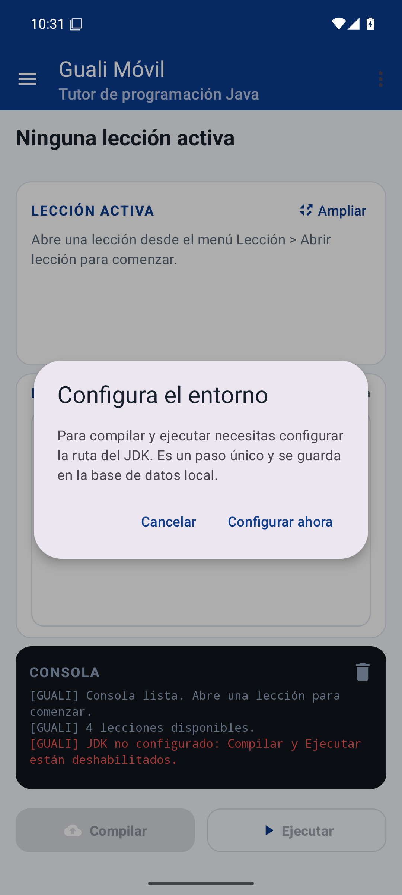

Abre **Configuración > Configurar JDK**, escribe la ruta y presiona **Guardar**. La ruta
se persiste en SQLite.

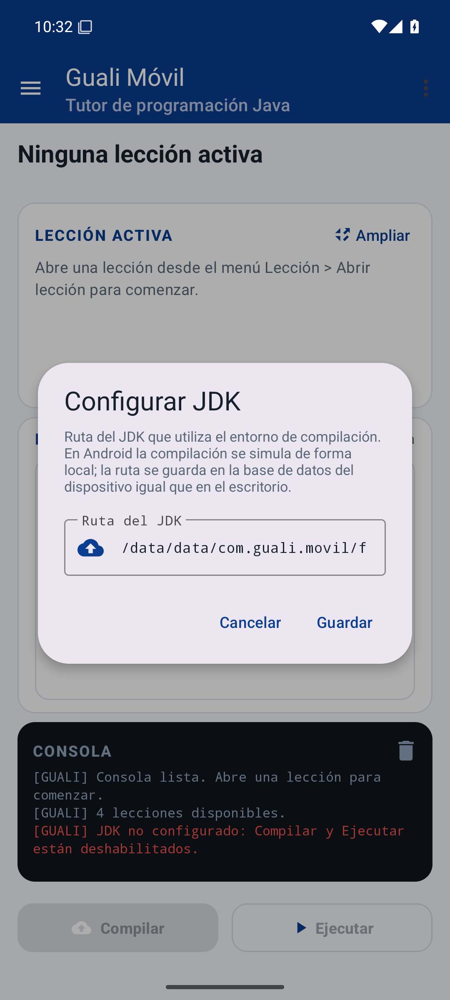

### 15.2 Panel de lecciones

Toca el icono de menú (arriba a la izquierda) o usa **Lección > Abrir lección**. El panel
lateral lista las cuatro lecciones con su objetivo y una marca si ya fueron completadas.

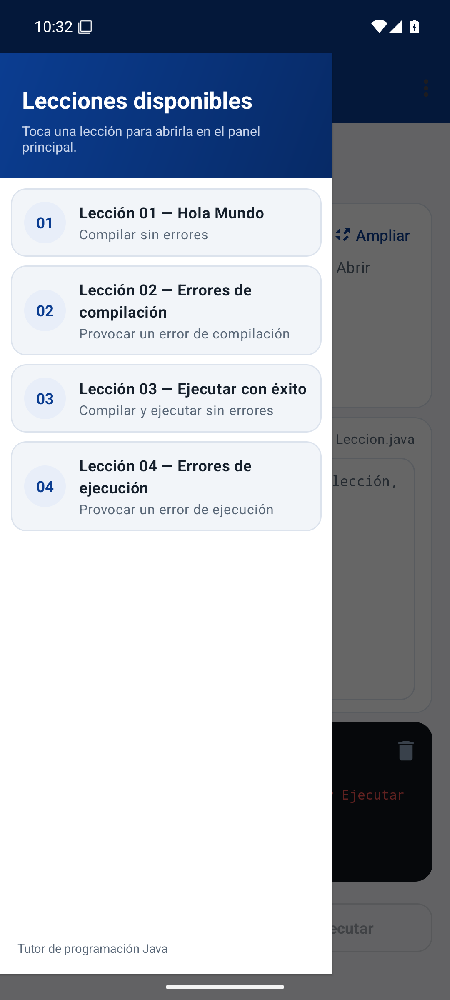

### 15.3 Lección abierta

Al tocar una lección se cargan el título, el objetivo, el contenido Markdown y la imagen.
El editor queda vacío para que copies el código a mano.


El botón **Ampliar** abre la lección en pantalla completa para leerla con comodidad:

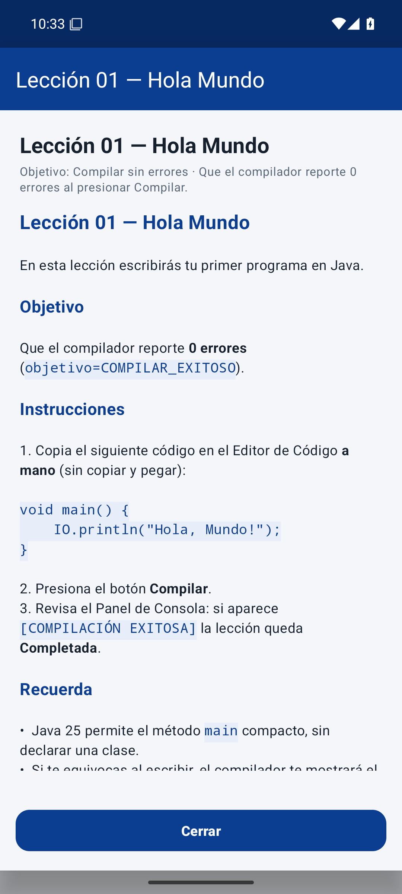

### 15.4 Compilar

Escribe el código de la lección en el editor y presiona **Compilar**. La consola muestra
el comando, el resultado y los errores con su línea:

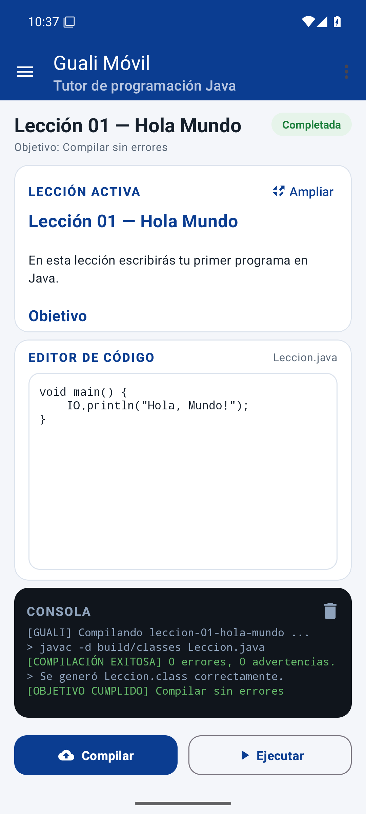

Si el código tiene un error, la consola lo indica y la lección queda **Pendiente**:

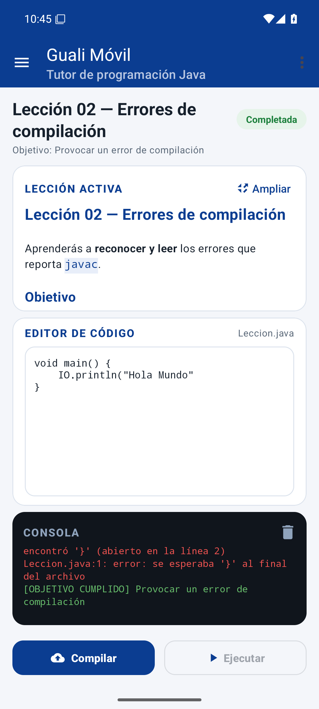

### 15.5 Ejecutar

Cuando la compilación fue exitosa, **Ejecutar** se habilita. La salida del programa
aparece en la consola:

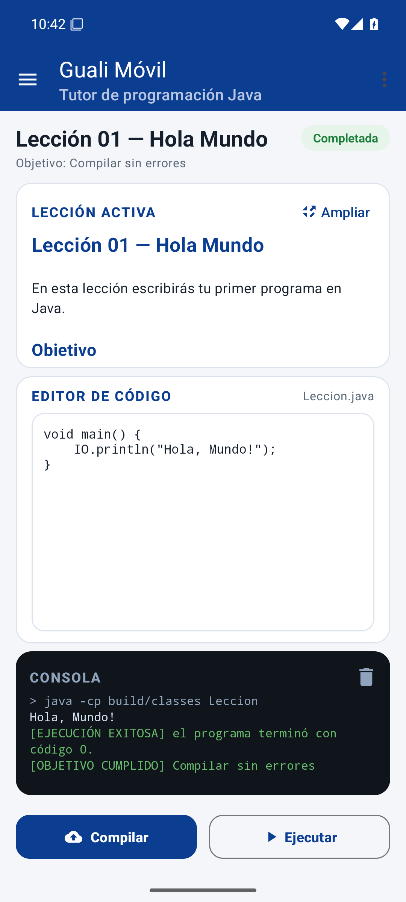

### 15.6 Objetivo cumplido

Al cumplirse la condición de la lección se muestra un diálogo y el estado cambia a
**Completada**:

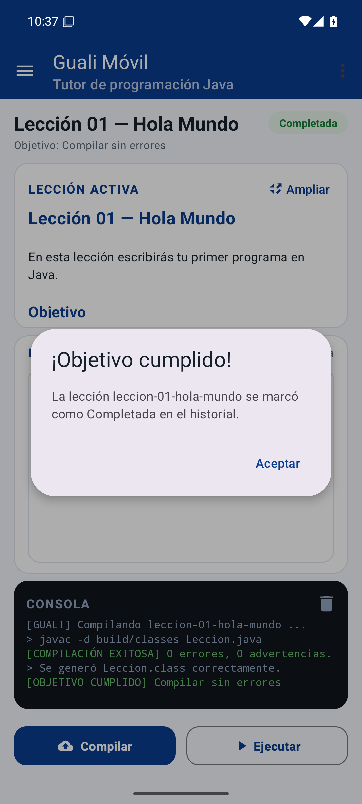

### 15.7 Historial

**Historial > Ver historial** muestra todos los intentos guardados, con lección, hora de
apertura, hora de cierre y estado. El historial sobrevive al cierre de la aplicación.

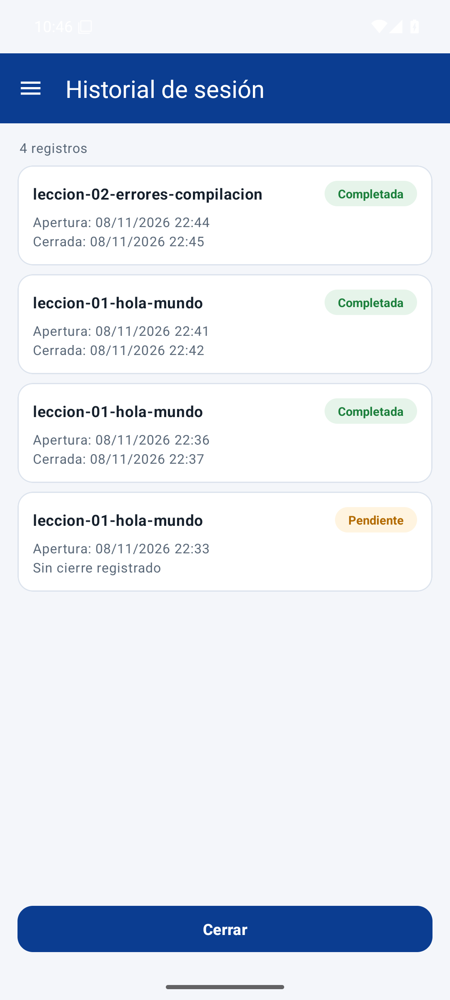

### 15.8 Ayuda

**Ayuda** abre una referencia rápida con los pasos y los tipos de objetivo:

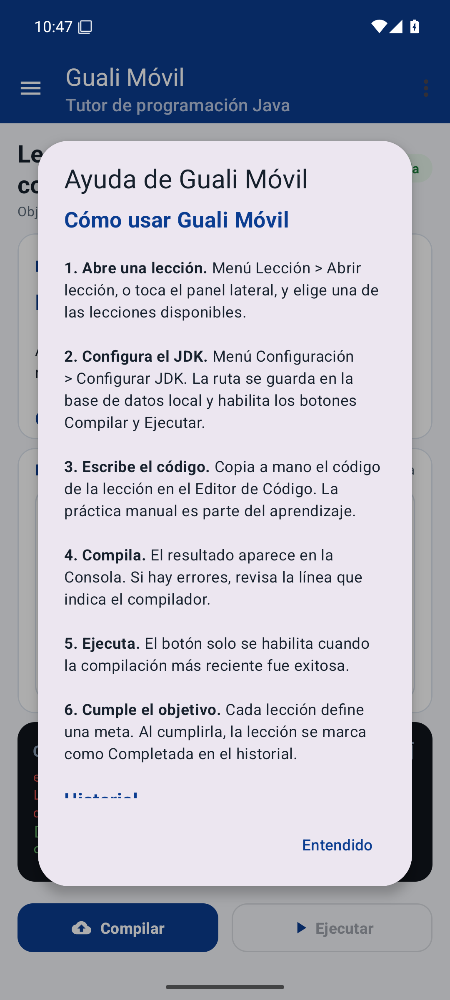

---

## 16. Pruebas sugeridas

| Prueba | Resultado esperado |
|---|---|
| Abrir la app sin JDK configurado | Compilar y Ejecutar deshabilitados, aviso visible |
| Configurar el JDK y guardar | Los botones se habilitan y la ruta persiste |
| Abrir `leccion-01-hola-mundo` y compilar el código | `[COMPILACIÓN EXITOSA] 0 errores` y estado **Completada** |
| Abrir `leccion-02-errores-compilacion` y compilar | `[COMPILACIÓN CON ERRORES]` con la línea del error |
| Compilar y ejecutar `leccion-03-ejecutar-exitoso` | `El producto de 6 x 7 = 42` y `[EJECUCIÓN EXITOSA]` |
| Compilar y ejecutar `leccion-04-errores-ejecucion` | `ArrayIndexOutOfBoundsException` y estado **Completada** |
| Cerrar y volver a abrir la app | El historial conserva los registros |
| Abrir **Historial** | Tabla con lección, apertura, cierre y estado |
| Abrir **Ayuda** | Referencia de funciones y objetivos |

---

## 17. Solución de problemas

| Síntoma | Solución |
|---|---|
| `SDK location not found` | Abre el proyecto en Android Studio para generar `local.properties`, o crea el archivo con `sdk.dir=C\:\\ruta\\al\\Sdk`. |
| Gradle no sincroniza | Revisa la conexión, usa **File > Invalidate Caches / Restart** y verifica el **Gradle JDK 17**. |
| Compilar/Ejecutar deshabilitados | Configura el JDK en **Configuración > Configurar JDK**. |
| El emulador no inicia | Habilita la virtualización en la BIOS y en las características de Windows (Hyper-V / WHPX). |
| `INSTALL_FAILED_UPDATE_INCOMPATIBLE` | Ejecuta `adb uninstall com.guali.movil` y vuelve a instalar. |
| No aparecen lecciones | Verifica que `app/src/main/assets/lecciones/` tenga las carpetas con `leccion.md` y `config.txt`. |
| La consola no muestra nada | Abre una lección primero; el botón Compilar se habilita al configurar el JDK y tener una lección activa. |

---

## 18. Autor

**Alexander Abigaíl Curtidor Lemus** — Carné **3190-23-16494**

Universidad Mariano Gálvez de Guatemala · Facultad de Ingeniería · Programación 2

Catedrático: **Ing. MGSi. César Hernández**
